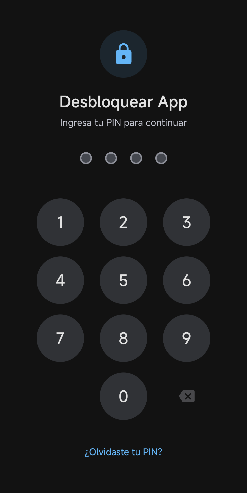
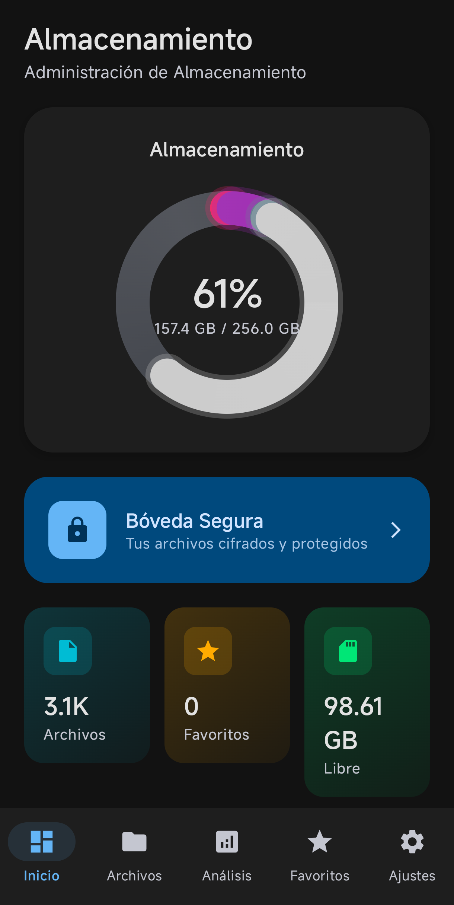
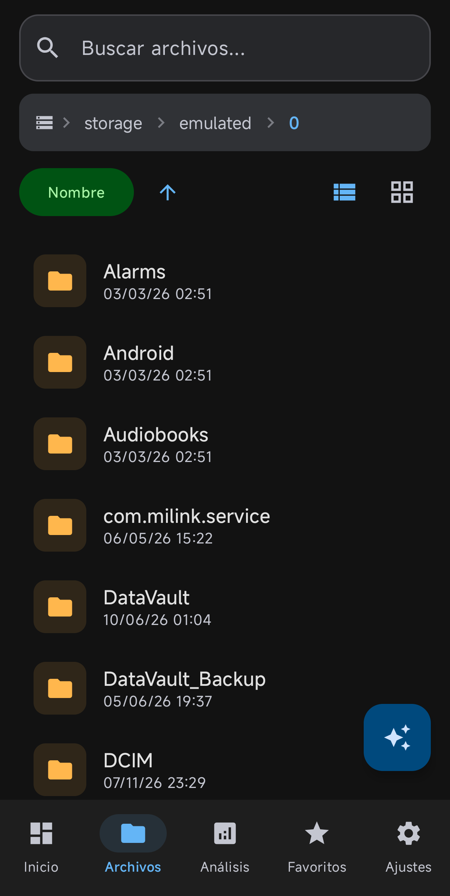
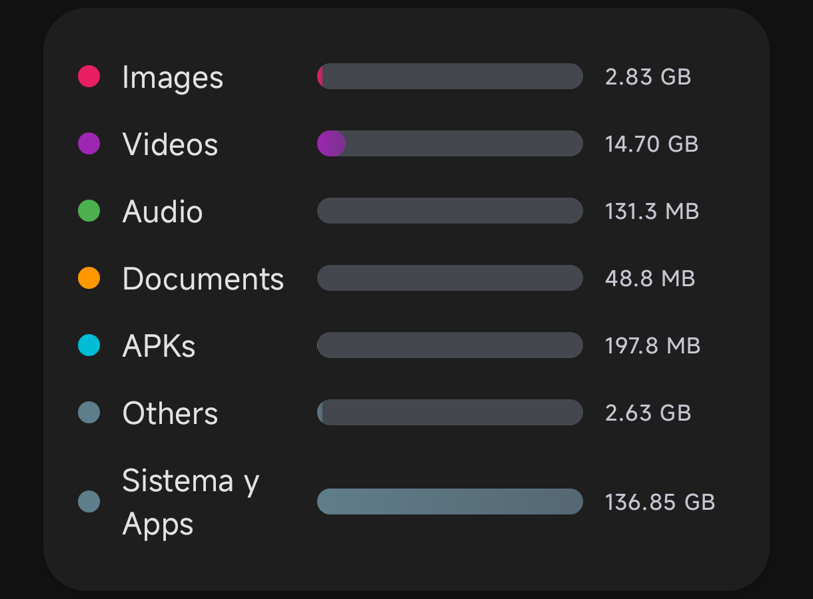
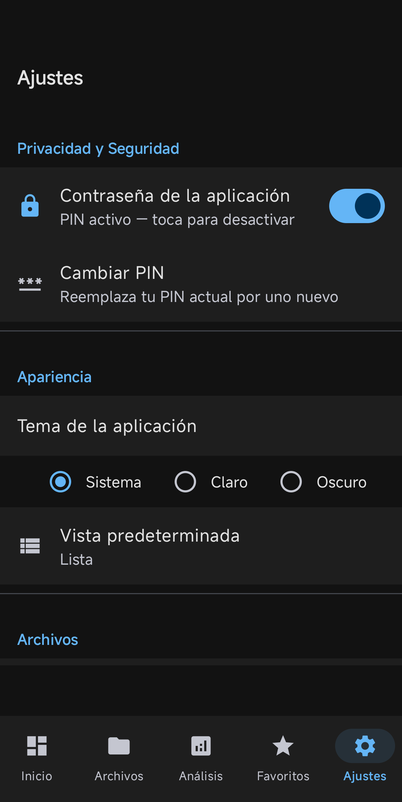

# DataVault — Android file vault with AI

DataVault is an Android app, written in Kotlin and Jetpack Compose, that organizes files on the device, finds duplicates, hides private files behind a PIN or biometric lock, and uses AI to summarize documents.

   

## Screenshots

| PIN lock | Dashboard | Explorer |
|---|---|---|
|  |  |  |
| **Storage analysis** | **Secure vault** | **Settings** |
|  |  |  |

*Captured on a POCO X7 Pro (Android 16).*

## Features

- **Dashboard & explorer:** storage overview by category, file browsing and favorites.
- **Private vault:** **AES-256** encrypted files, PIN or **biometric** unlock, and auto-lock after 3 minutes of inactivity.
- **Duplicate analysis:** finds repeated files so you can reclaim space.
- **AI assistant:** summarizes documents (PDF text extraction with PDFBox) and answers questions about them, using Gemini and OpenRouter models.
- **Cloud backup:** Google sign-in with Firebase Auth, and backup to Google Drive through the Drive v3 API.

## Tech

| Layer | Stack |
|---|---|
| UI | Jetpack Compose, Material 3, Navigation 3, animations |
| Architecture | MVVM (ViewModels + repositories) |
| Persistence | Room (3 entities / 3 DAOs), DataStore preferences |
| Networking | Retrofit, OkHttp, Gson |
| Security | AES-256-CBC, AndroidX Biometric |
| Cloud | Firebase Auth, Google Drive API |
| Logging | Timber |

**65 Kotlin files, about 9.8k lines, 10 screens:**
- Splash
- PIN
- PIN setup
- Dashboard
- Explorer
- Vault
- Favorites
- Analysis
- AI
- Settings

## Build

1. Open the project in Android Studio (JDK 17).
2. Add your own keys to `local.properties`. This file is never committed.
   ```properties
   GEMINI_API_KEY=your_key
   OPENROUTER_API_KEY=your_key
   ```
3. Add `app/google-services.json` from your own Firebase project. It is also kept out of git.
4. Run the `app` configuration.

## Roadmap

- Unit tests for the repositories and the encryption service.
- A real release signing config.
- Rename the package from `com.example`.

---
Author: **Jovany Morales del Ángel** · MIT License
